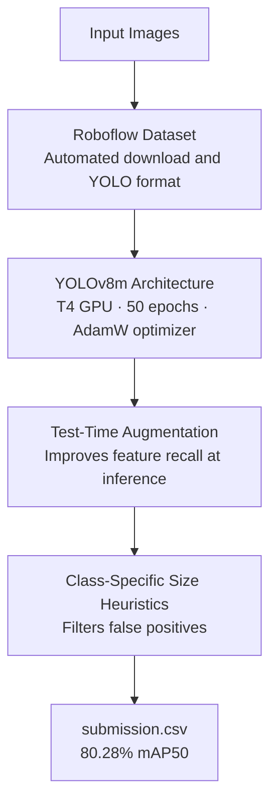

# 🏆 PCB Defect Detection 

[](https://colab.research.google.com/drive/1rNyNzX7uO0CLGNAEE_0wqQ7PajajdlRV?usp=sharing)

An end-to-end computer vision pipeline developed for automated Printed Circuit Board (PCB) defect detection using **YOLOv8m**, augmented with class-specific geometry-based post-processing heuristics to eliminate false positives and maximize mAP.

---

## 🚀 Project Overview
This repository contains the training configuration, model weights, evaluation pipeline, and automated inference script designed to detect four critical PCB manufacturing defects:
* `open_circuit`
* `short`
* `spur` / `spurious_copper`
* `mouse_bite`

---

## 🔄 Pipeline at a Glance



---

## 📂 How to Use the Test Set and Evaluate Results

To test the model on your dataset, verify performance using ground truth labels, and generate the final submission CSV, follow these steps in your Google Colab notebook:

### 1. Upload and Extract the Test Dataset
Ensure your test dataset archive (containing both images and labels structured in standard YOLO format) is uploaded to your Colab environment, then extract it to `/content/test` using:
```python
!unzip -q /content/test.zip -d /content/
```

### 2. Evaluate Model Accuracy (mAP)
To evaluate the trained model against the test set labels and view your mAP metrics, run the following evaluation script:
```python
import yaml
from ultralytics import YOLO

# Load trained weights
model = YOLO('/content/runs/detect/pcb_hackathon/best_yolov8m/weights/best.pt')

# Create a temporary config pointing to your test images and labels
test_yaml = {
    'path': '/content/test',
    'train': 'images',
    'val': 'images',
    'names': model.names
}

with open('/content/test_evaluate.yaml', 'w') as f:
    yaml.dump(test_yaml, f)

# Run validation metrics
metrics = model.val(data='/content/test_evaluate.yaml', conf=0.001, iou=0.6, augment=True)
print(f"🏆 Test mAP50: {metrics.box.map50 * 100:.2f}% | mAP50-95: {metrics.box.map * 100:.2f}%")
```

### 3. Run Inference and Generate `submission.csv`
To run optimized inference with Test-Time Augmentation (TTA) and class-specific size heuristics that filter out false-positive hallucinations, execute the final pipeline script:
```python
import os
import glob
import pandas as pd
from ultralytics import YOLO
from google.colab import files

model = YOLO('/content/runs/detect/pcb_hackathon/best_yolov8m/weights/best.pt')
test_images_dir = '/content/test/images'
image_paths = glob.glob(os.path.join(test_images_dir, '*.*'))

class_size_limits = {
    0: {'max_w': 0.15, 'max_h': 0.15},  # open_circuit
    1: {'max_w': 0.18, 'max_h': 0.18},  # short
    2: {'max_w': 0.12, 'max_h': 0.12},  # spur / spurious copper
    3: {'max_w': 0.10, 'max_h': 0.10}   # mouse_bite
}

submission_rows = []

for img_path in image_paths:
    filename = os.path.basename(img_path)
    results = model.predict(source=img_path, conf=0.001, iou=0.6, augment=True, verbose=False)
    
    for r in results:
        boxes = r.boxes
        if len(boxes) == 0:
            continue
        
        coords = boxes.xyxy.cpu().numpy()
        norm_boxes = boxes.xywhn.cpu().numpy()
        confs = boxes.conf.cpu().numpy()
        classes = boxes.cls.cpu().numpy().astype(int)
        
        for box, norm_box, conf, cls_idx in zip(coords, norm_boxes, confs, classes):
            norm_w, norm_h = norm_box[2], norm_box[3]
            
            if cls_idx in class_size_limits:
                limit = class_size_limits[cls_idx]
                if norm_w > limit['max_w'] or norm_h > limit['max_h']:
                    continue
            
            x_min, y_min, x_max, y_max = box
            x_min, y_min = max(0, x_min), max(0, y_min)
            
            submission_rows.append({
                'image_name': filename,
                'class_name': model.names[cls_idx],
                'x_min': round(float(x_min), 2),
                'y_min': round(float(y_min), 2),
                'x_max': round(float(x_max), 2),
                'y_max': round(float(y_max), 2),
                'confidence': round(float(conf), 4)
            })

df = pd.DataFrame(submission_rows)
df.to_csv('submission.csv', index=False)
print(f"Success! Generated {len(submission_rows)} predictions.")
files.download('submission.csv')
```

---

## 🛠️ Training Methodology & Hyperparameters
The model was trained on a T4 GPU utilizing a Roboflow dataset pipeline.

* **Architecture:** YOLOv8m (Medium model selected for an optimal balance of feature representation and inference speed)
* **Epochs:** 50 (with early stopping patience set to 15)
* **Image Size:** `640x640`
* **Batch Size:** `16`
* **Optimizer:** AdamW
* **Initial Learning Rate (`lr0`):** `0.001`
* **Data Augmentation:** Test-Time Augmentation (TTA) enabled during inference

---

## 📐 Advanced Heuristic Post-Processing
To mitigate false positive hallucinations from low-confidence scanning thresholds, a custom **Class-Specific Size Limit Heuristic** was implemented in normalized dimensions (`xywhn`):

```python
class_size_limits = {
    0: {'max_w': 0.15, 'max_h': 0.15},  # open_circuit
    1: {'max_w': 0.18, 'max_h': 0.18},  # short
    2: {'max_w': 0.12, 'max_h': 0.12},  # spur / spurious copper
    3: {'max_w': 0.10, 'max_h': 0.10}   # mouse_bite
}
```
Any bounding box exceeding these structural geometric thresholds is automatically filtered out.

---

## 📊 Results Summary

The final evaluation on the test dataset, combining the fine-tuned YOLOv8m weights with class-specific geometry filters and Test-Time Augmentation (TTA), yielded the following performance metrics:

* **Overall Test mAP50:** **80.28%**
* **Overall Test mAP50-95:** **31.10%**

### Class-Specific Validation Breakdown
* **Short:** mAP50 = 84.30%
* **Spur:** mAP50 = 81.10%
* **Spurious Copper:** mAP50 = 76.60%
* **Missing Hole:** mAP50 = 76.80%
* **Open Circuit:** mAP50 = 62.80%
* **Mouse Bite:** mAP50 = 66.30%
